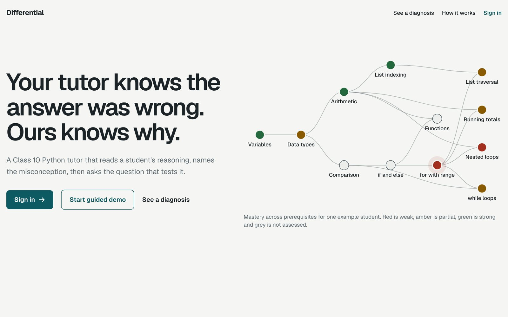
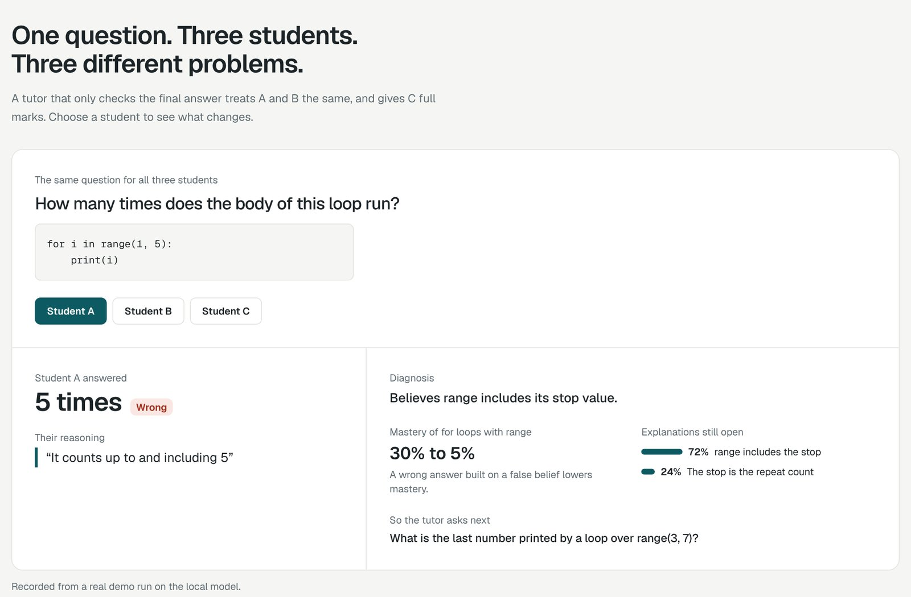
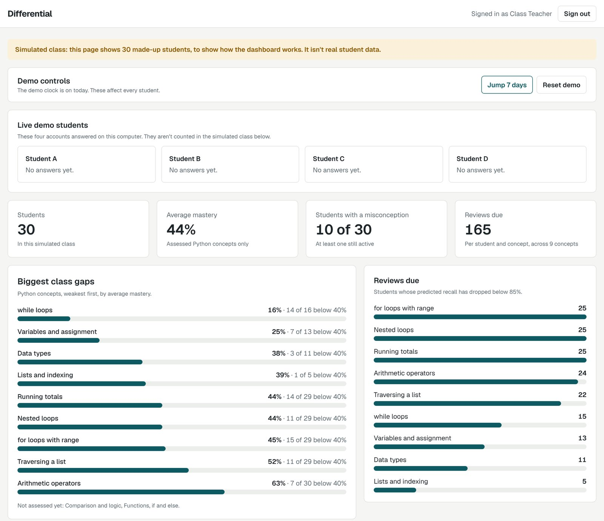
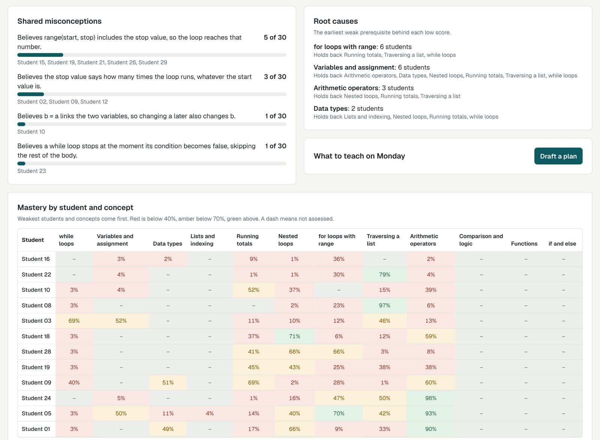

# Differential

**Your tutor knows the answer was wrong. Ours knows why.**

Differential is a Class 10 Python programming tutor that diagnoses a student's reasoning, not just their final answer. It works like a doctor making a differential diagnosis: it forms competing explanations for a mistake, then asks the question that best separates them. Everything runs on one PC with a local model.

Built by team **Works Locally** (Karthikeyan and Nandini) for the Product Space AI Hackathon, on the problem statement *Adaptive exam-prep tutor with a learner model*.



**Submission document:** [Markdown](docs/SUBMISSION.md) | [PDF](docs/Differential-Works-Locally-Hackathon-Submission.pdf)

## Contents

- [The idea in one example](#the-idea-in-one-example)
- [How each requirement is met](#how-each-requirement-is-met)
- [How it works](#how-it-works)
- [Measured accuracy](#measured-accuracy)
- [Quick start](#quick-start)
- [Guided demo](#guided-demo)
- [Demo accounts](#demo-accounts)
- [Project structure](#project-structure)
- [Tests](#tests)
- [Limits](#limits)

## The idea in one example

Three students answer: *"How many times does the body of `for i in range(1, 5):` run?"*

| Student | Answer | Reasoning | Diagnosis | Mastery | Next question tests |
|---|---|---|---|---|---|
| A | 5 times | "It counts up to and including 5" | Thinks `range` includes its stop value | Falls | The last number printed by `range(3, 7)` |
| B | 5 times | "The 5 says how many times" | Thinks the stop value is the number of repeats | Falls | How many times `range(4, 6)` runs |
| C | 4 times | "It is always one less than the stop number" | Right answer, wrong reason | Unchanged | How many times `range(3, 8)` runs |

An answer-only tutor treats A and B the same and gives C full marks.



## How each requirement is met

| Requirement | What we built | Where |
|---|---|---|
| Diagnostic test | 8 adaptive questions, each with written reasoning and a confidence tap | `engine/selection.py` |
| Concept graph for one syllabus | 29 linked concepts across Class 10 computer science. Python Programming is assessed, and Computer Networks, Web Pages with HTML and Cyber Ethics complete the graph | `content/concepts.json`, `engine/graph.py` |
| Learner model updated after every answer | Bayesian Knowledge Tracing per concept, and a probability per misconception | `engine/mastery.py`, `engine/misconceptions.py` |
| Question generation for weak concepts, with difficulty calibration | Code picks the target and the difficulty. Generated questions use fixed program templates, and code works out the correct answer. Elo ratings adjust difficulty from class responses | `engine/selection.py`, `engine/elo.py`, `agent/generate.py`, `agent/solvers.py` |
| Misconception detection from reasoning | A local LLM matches the reasoning to a catalogue and must quote the student's own words | `agent/diagnose.py`, `content/misconceptions.json` |
| Spaced-repetition scheduling | A forgetting curve per concept and per cleared misconception | `engine/scheduling.py` |
| Teacher dashboard of class-wide gaps | Biggest gaps, reviews due, shared misconceptions, root causes, a heatmap, difficulty surprises and a draft lesson plan | `engine/class_summary.py`, `agent/plan.py`, `web/src/pages/TeacherPage.tsx` |





The dashboard uses a simulated class of 30 made-up students, and is labelled that way.

## How it works

The main rule is that **the LLM interprets and the code decides.** The LLM never sets a score, marks an answer or chooses a question, and code written by the LLM is never run.

```text
React app  ->  FastAPI  ->  agent loop  ->  agent/llm.py  ->  Ollama (local model)
                               |
                               +-> engine/ (pure, unit-tested functions)
                               +-> SQLite + content JSON
```

On every answer:

1. **Check:** code marks the selected option right or wrong.
2. **Diagnose:** the local LLM reads the reasoning and returns structured data.
3. **Validate:** code rejects the diagnosis unless it fits the catalogue and quotes the student's own words.
4. **Update:** code moves mastery, misconception probabilities, reviews and difficulty.
5. **Decide:** code picks the question that best separates what's left.

The student sees each of these steps in a "What the agent is thinking" panel. If the LLM is down or slow, the answer is still saved and scored from the selected option.

**Tech stack:** Python, FastAPI and SQLModel on SQLite, Ollama running `qwen3.5:9b`, and React, TypeScript, Vite, Tailwind CSS and React Flow.

## Measured accuracy

Measured on `qwen3.5:9b` with thinking off, using 30 held-out written test cases that weren't used for tuning:

| Measure | Result |
|---|---|
| Error type correct | 30 of 30 (100%) |
| Misconception identified, where one was expected | 18 of 18 (100%) |
| Average time per diagnosis | 0.8 seconds |

These are written test cases, not real student data, and the same AI assistant that helped write the misconception list also wrote them, in fairly clear wording. Expect real students to be harder, so treat the result as a check that the system works, not as evidence of accuracy with real students. Full results are in [`eval/results.json`](eval/results.json).

## Quick start

You need Python 3.12 or later, Node 20 or later, and [Ollama](https://ollama.com) running locally. The `.venv/Scripts` paths are for Windows. On macOS or Linux, use `.venv/bin`.

**1. Get the code and the model**

```bash
git clone https://github.com/Karthikeyan-2001/agentic-ai-hackathon.git
```
```bash
cd agentic-ai-hackathon
```
```bash
ollama pull qwen3.5:9b
```

**2. Install and build**

```bash
python -m venv .venv
```
```bash
.venv/Scripts/pip install -r requirements.txt
```
```bash
npm --prefix web install
```
```bash
npm --prefix web run build
```

**3. Prepare the demo data and start the app**

```bash
.venv/Scripts/python -m scripts.seed_class
```
```bash
.venv/Scripts/python -m scripts.warm_demo
```
```bash
.venv/Scripts/python -m uvicorn api.main:app --port 8000
```

Then open http://localhost:8000 and click **Start guided demo**. `seed_class` creates the simulated class, and `warm_demo` runs the demo answers through the model once and caches them.

## Guided demo

**Start guided demo** takes about 4 minutes. It resets the four demo students, then a bar at the bottom of the page walks through 9 steps, switching accounts for you:

1. **Student A** has a misconception, and the next question tests it.
2. **Student B** gives the same wrong answer for a different reason, and gets a different diagnosis.
3. **Student C** gives the right answer for the wrong reason, so mastery doesn't move.
4. **Student D** takes the 8-question diagnostic, then the concept map shows the weak spot.
5. **Student D** gets a generated question on the weakest concept.
6. **Teacher** clicks **Jump 7 days**.
7. **Student C** has a spaced review come due.
8. **Teacher** shows class-wide gaps and drafts the Monday plan.
9. **Close** shows the accuracy result and how it was measured.

Each form is filled in from `content/demo_script.json`, so you only click **Submit answer**, **Next question** and **Next step**. The answers still go through the same diagnosis and scoring as typed ones. `warm_demo` caches them, so they work even if Ollama stops, and it fails loudly if the tutor stops following the script.

## Demo accounts

These are mock accounts for the local demo. The login page also has a one-click button for each one.

| Role | Username | Password |
|---|---|---|
| Teacher | `teacher` | `Teacher-Demo-2026` |
| Student A | `student.a` | `Student-A-2026` |
| Student B | `student.b` | `Student-B-2026` |
| Student C | `student.c` | `Student-C-2026` |
| Student D (takes the diagnostic) | `student.d` | `Student-D-2026` |

The server checks the role on every API request. Students can only see and answer their own questions, and only the teacher can see the class dashboard or use **Jump 7 days** and **Reset demo**. The teacher can read a student's progress, but can't answer for them.

The passwords are in the code in plain text, sessions are kept in memory, and restarting the server signs everyone out. This separates roles for a demo, and it isn't real security.

## Project structure

| Folder | What it holds |
|---|---|
| `content/` | Concept graph, misconceptions, questions, demo script and evaluation samples. The app needs these to run |
| `engine/` | Mastery, misconceptions, scheduling, Elo, graph, selection and class summary. Pure code with no LLM, database, network or system clock |
| `agent/` | LLM client, diagnosis, question generation, solvers, lesson plan and the agent loop |
| `api/` | Database tables, persistence, routes and mock sign-in |
| `scripts/` | Seeding the simulated class, pre-generating questions, evaluation and demo tools |
| `web/` | React app: landing page, student app, teacher dashboard and guided demo |
| `tests/` | Engine, content, agent, API and sign-in tests |
| `eval/` | Results of the accuracy evaluation |
| `docs/` | Submission document and screenshots |

## Tests

```bash
.venv/Scripts/python -m pytest
```

This runs 302 tests with a fake LLM, so it doesn't need Ollama. To run the demo cases against the real model:

```bash
.venv/Scripts/python -m pytest -m llm
```

## Limits

- Questions cover Python Programming only. Other chapters appear in the graph as "not assessed".
- Comparison and logic, if and else, and functions have no questions yet.
- Code can generate new questions for arithmetic, running totals, nested loops and list traversal only. A student who stays weak on any other concept cycles through its existing questions. If generation fails, the student sees an older question again.
- Sign-in is mock, so this runs as a local demo. Don't expose it to the internet as it is.
- No real student has used it yet.
- The AI-written lesson plan is a draft for a teacher to review.

## License

[MIT](LICENSE)
